# BookMyTable — Restaurant Table Reservation System

**BookMyTable** is a full-stack web application built with **Python / Django** that lets diners reserve tables at a restaurant online and lets restaurant staff manage tables, menu items and reservations through a dedicated administration interface.

- 🔗 **Live site:** <https://bookmytable-8de20a7bca65.herokuapp.com/>
- 📦 **Source code:** <https://github.com/xttrust/BookMyTable>
- 📄 **Software Development Document** (graduation paper): see the [Documentation](#documentation) section

---

## Table of Contents

- [Project Overview](#project-overview)
- [Site Goals](#site-goals)
- [Scope](#scope)
- [User Stories](#user-stories)
- [Features](#features)
- [Technologies Used](#technologies-used)
- [Project Structure](#project-structure)
- [Setup and Installation](#setup-and-installation)
- [Testing](#testing)
- [Deployment](#deployment)
- [Documentation](#documentation)
- [Credits and Acknowledgements](#credits-and-acknowledgements)

---

## Project Overview

Traditional telephone-based table reservations are slow, error-prone and hard to keep track of. **BookMyTable** digitises the complete restaurant reservation lifecycle:

- **Diners** can register, log in, browse the menu, view the restaurant tables, make a reservation (date, time, party size, table and special requests), and view, edit or cancel their own reservations.
- **Restaurant staff** use the Django admin back office to manage tables, menu categories, menu items (name, description, price, image) and all reservations and customer enquiries.

The application enforces real business rules automatically:

- Party size between **1 and 60** people
- Reservations only between **08:00 and 21:00**
- A user cannot hold **two reservations on the same date**
- The combined party size for the same date/time slot cannot exceed the **restaurant capacity of 60 people**

## Site Goals

1. Simplify the restaurant reservation process with an intuitive, mobile-friendly booking flow.
2. Enhance the dining experience with an up-to-date, browsable menu and clear booking confirmations.
3. Streamline menu management so staff can update categories and items quickly.
4. Improve administrative efficiency with a central dashboard for reservations, tables and enquiries.
5. Guarantee data accuracy through server-side validation of capacity, duplicate bookings and operating hours.
6. Follow systematic software engineering practice (requirements analysis, design, implementation, testing) as documented in the graduation paper.

## Scope

The project covers: user account management (registration/login/logout via django-allauth), the table reservation system (make, view, edit, delete), capacity and rule enforcement, menu management, a contact form for customer enquiries, and comprehensive automated testing. Out of scope: online payments, take-away ordering/delivery, guest-facing table-availability dashboards, and multi-language support.

## User Stories

### Epics

| Epic | Stories (abbreviated) |
| ---- | --------------------- |
| **Epic 1 — User Account Management** | As a user I can register for an account; I can log in to access my reservations. |
| **Epic 2 — Table Reservation** | As a user I can view available tables; I can book a table; I can view and manage my upcoming reservations; I can see a booking confirmation. |
| **Epic 3 — Admin Management** | As an admin I can manage all reservations; I can manage menu items; I can manage menu categories; I can display formatted descriptions in the admin list view. |
| **Epic 4 — System Notifications** | As a user I receive notifications on login, logout, registration, reservation creation/update/deletion. |
| **Epic 5 — Testing and Documentation** | As a developer I can write tests; I can write documentation. |

### Example user stories

- As a **new user**, I can **register for an account** so that I can make and manage reservations.
- As a **new user**, I can **log into my account** so that I can access my reservations and profile.
- As a **user**, I can **view available tables for a specific date and time** so that I can choose a suitable table.
- As a **user**, I can **book a table** so that I can dine at the restaurant.
- As a **user**, I can **view my upcoming reservations** so that I can manage my bookings.
- As a **user**, I can **see a booking confirmation on the website** so that I have proof of my reservation.
- As an **admin**, I can **view and manage all bookings** so that I can ensure smooth operations.
- As an **admin**, I can **manage menu items and menu categories** so that I can keep the restaurant's offerings up to date.

---

## Features

### Navigation & Footer

The responsive Bootstrap 5 navbar is consistent across all pages. Unauthenticated visitors see **Home · Menu · About · Contact · Register · Login**; authenticated users get an **Account** dropdown with **Reserve a Table**, **My Reservations** and (for staff) **Admin**. On mobile the menu collapses into a hamburger icon.

| Desktop | Mobile |
| ------- | ------ |
| 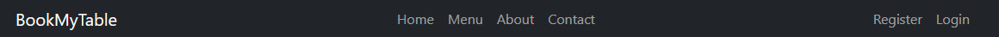 | 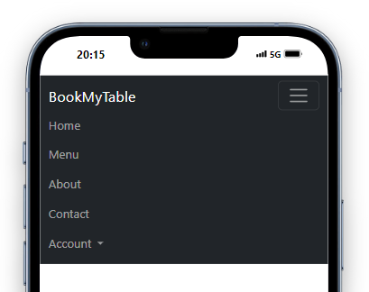 |

| Authenticated | Unauthenticated |
| ------------- | --------------- |
| 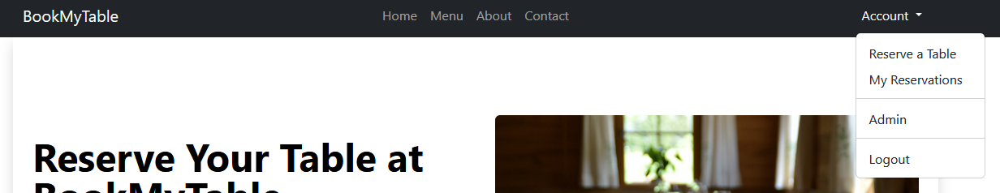 | 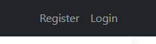 |

The footer contains the brand, copyright line and social links.

### Home Page (Hero + About + Menu preview)

The landing page greets visitors with a hero section and a **“Book your table now”** call to action, an **About Us** section, and a preview of the current menu (first 9 items per category).

| Desktop | Mobile |
| ------- | ------ |
| 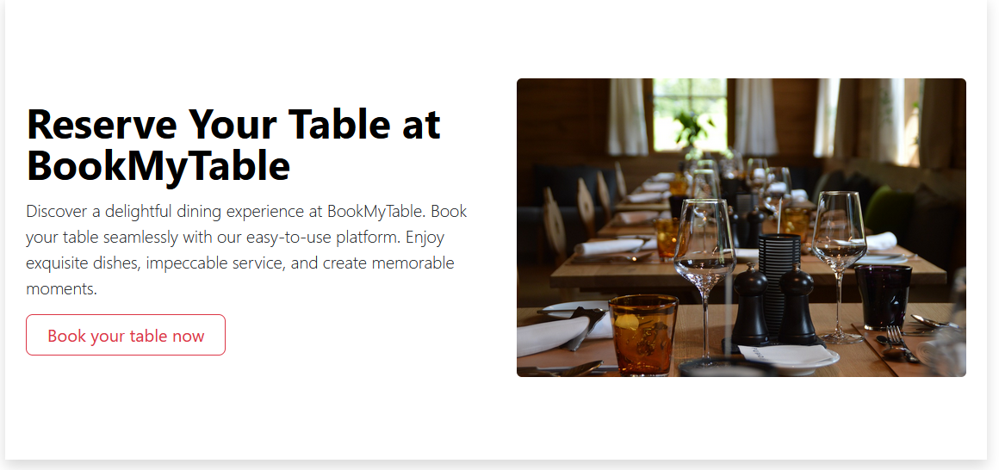 | 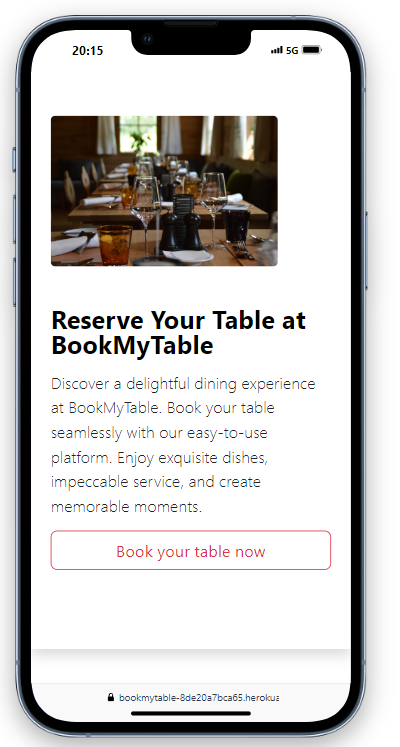 |

| About desktop | About mobile |
| ------------- | ------------ |
| 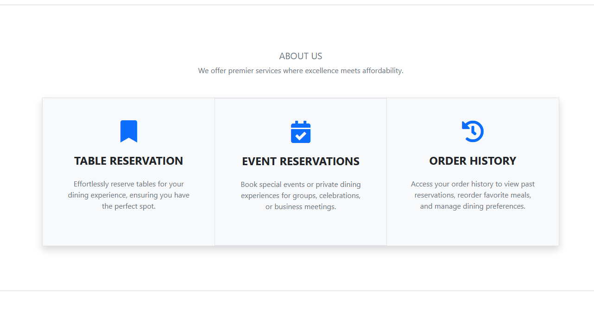 | 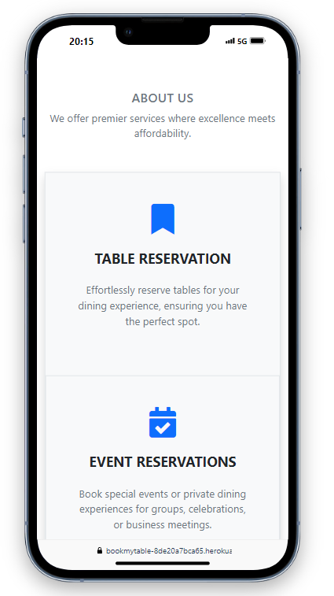 |

### Menu

The menu page groups items by category in a tabbed layout with pagination (9 items per category). Every card shows the dish image (or a placeholder when no image exists), its description and its price.

| Desktop | Mobile |
| ------- | ------ |
| 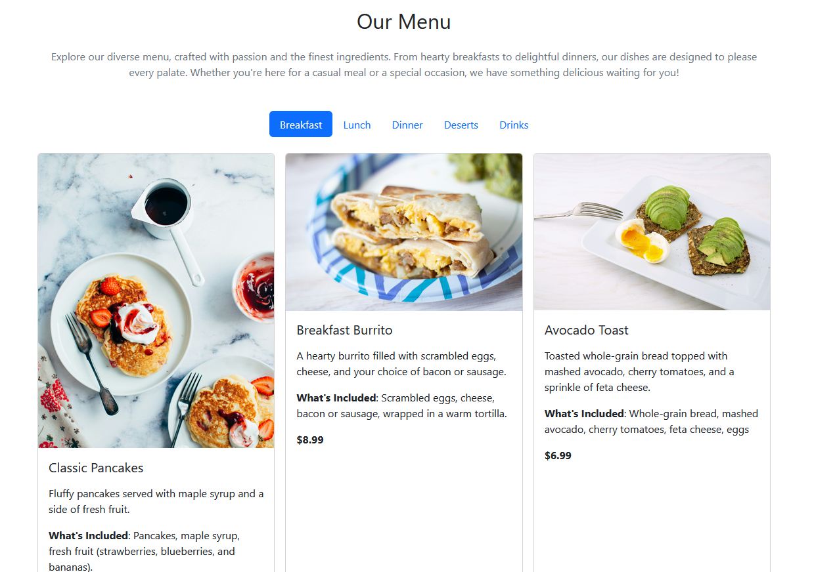 | 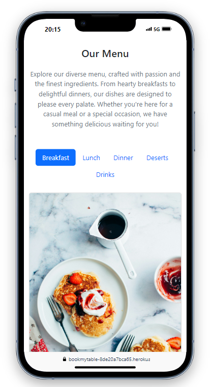 |

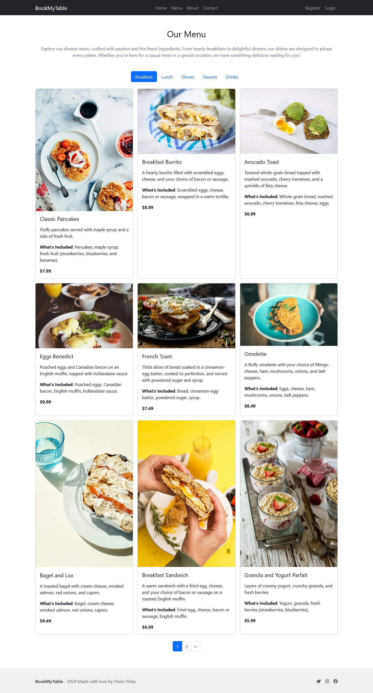

### User Registration & Login

Register and login are handled by **django-allauth**, providing secure session-based authentication with clear validation feedback.

| Register desktop | Register mobile |
| ---------------- | --------------- |
| 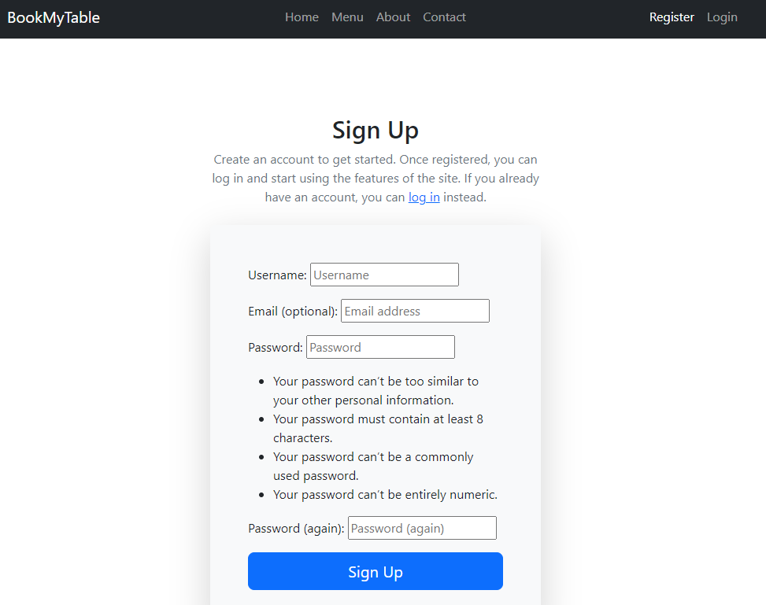 | 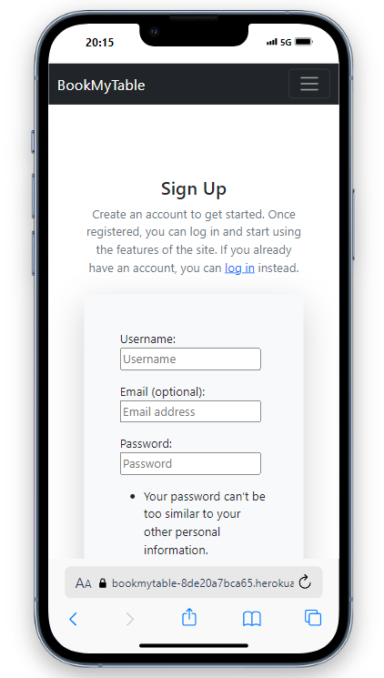 |

| Login desktop | Login mobile |
| ------------- | ------------ |
| 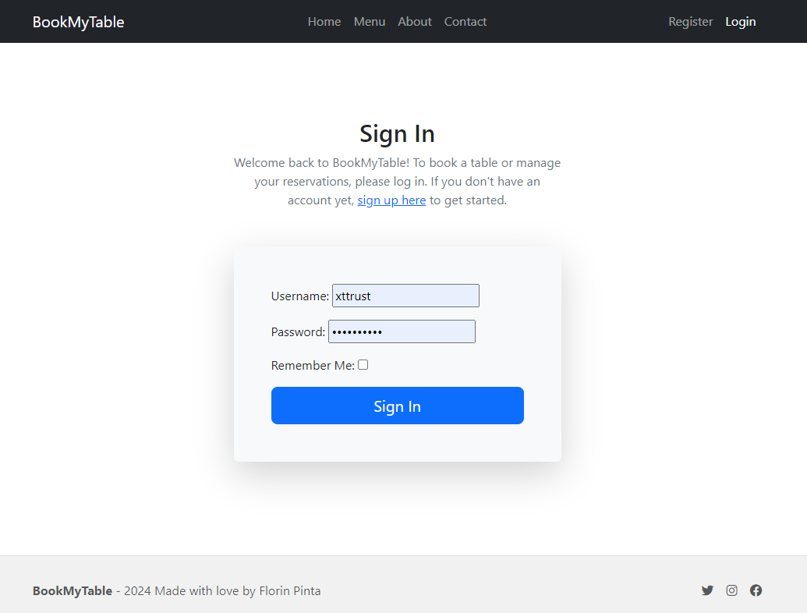 | 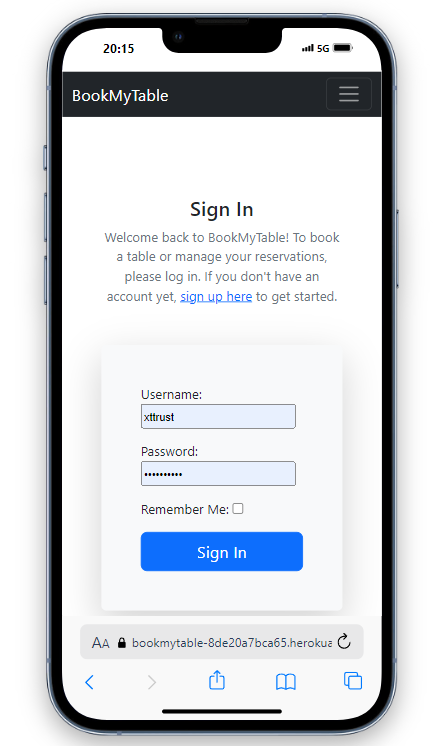 |

### Logout

A logout confirmation page lets users securely end their session and provides a link to log back in.

| Desktop | Mobile |
| ------- | ------ |
| 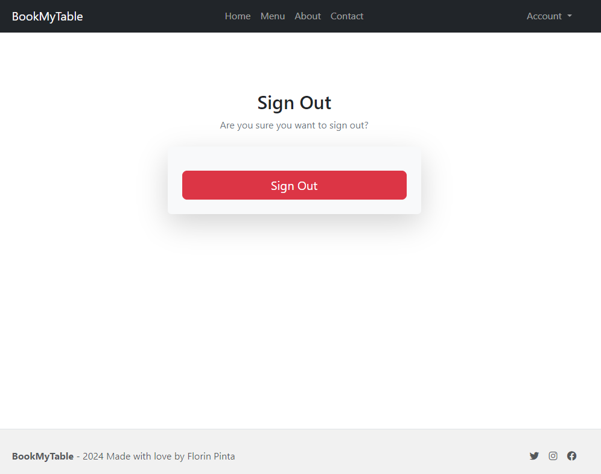 | 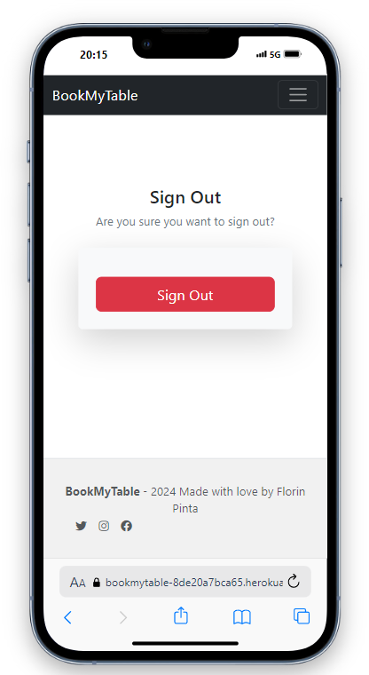 |

### Reserve a Table

Authenticated users open a reservation form pre-filled with their name and email. They select a **date**, **time**, **party size** and **table**, and may add special requests. The server validates everything and displays friendly error messages for invalid input, duplicate dates, out-of-hours times and capacity limits.

| Desktop | Mobile |
| ------- | ------ |
| 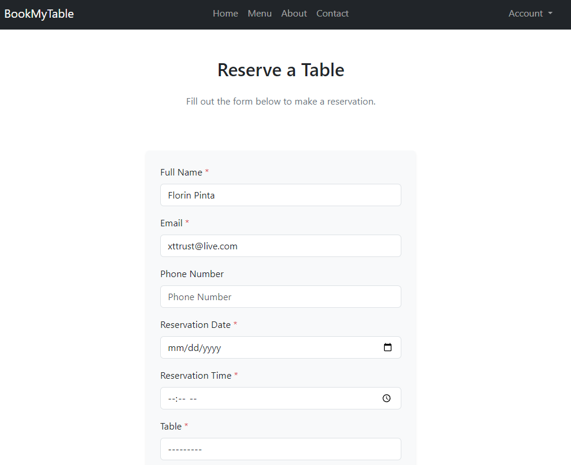 | 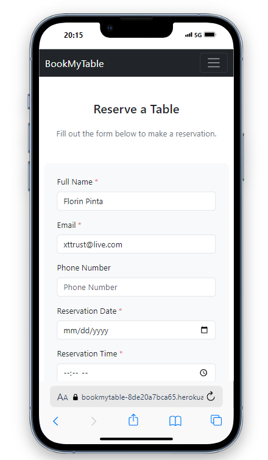 |

| Capacity-limit message | Duplicate-booking message | Login-required message |
| ---------------------- | ------------------------ | --------------------- |
| 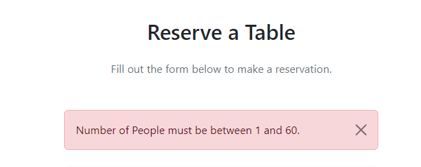 | 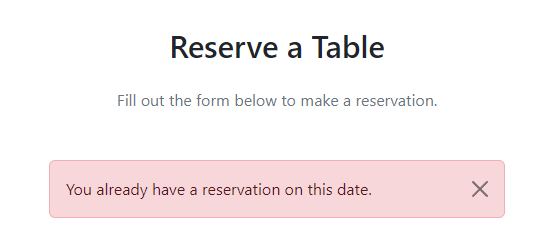 | 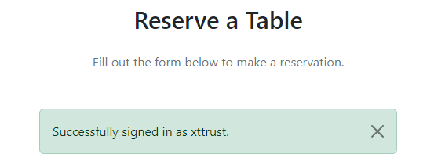 |

### My Reservations

Users see a table of all their bookings with **Edit** and **Delete** actions (with delete confirmation). An empty state informs users when they have no reservations yet.

| Desktop | Mobile |
| ------- | ------ |
| 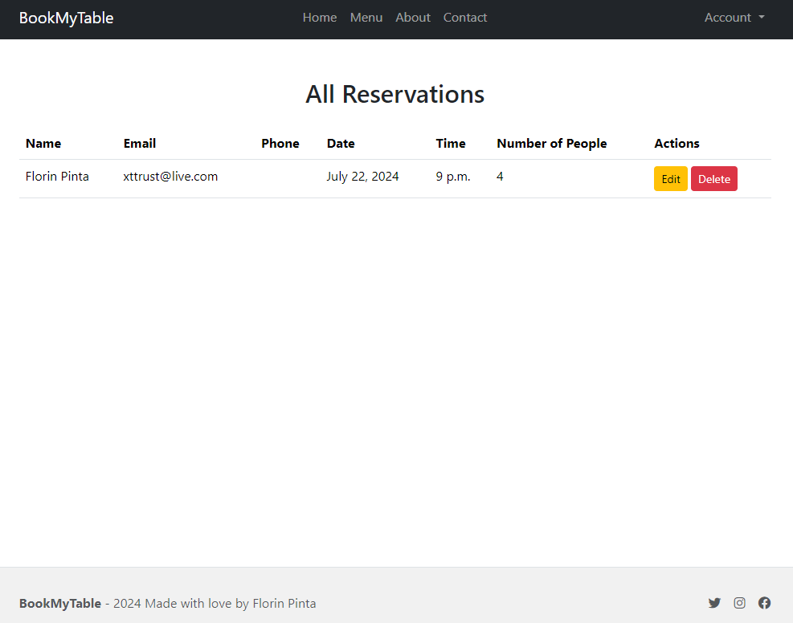 | 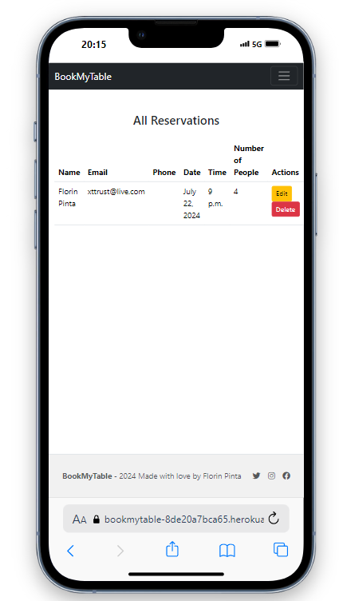 |

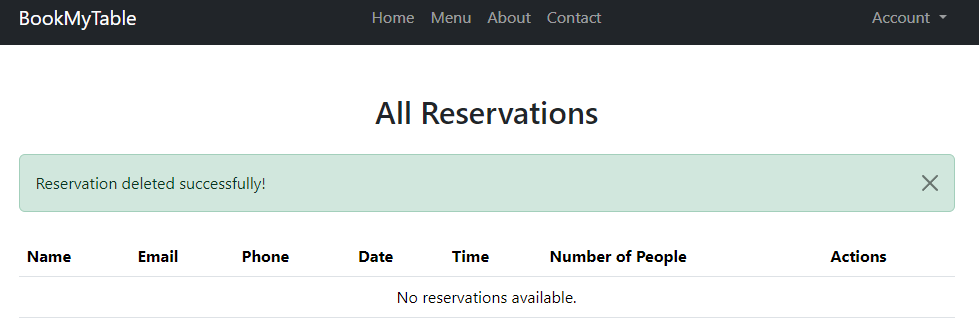

### Contact Form

The contact page lets any visitor send an enquiry (full name, email, phone, message up to 500 characters). Valid submissions are stored in the database and acknowledged with a success message.

| Contact form | Success message |
| ------------ | --------------- |
| 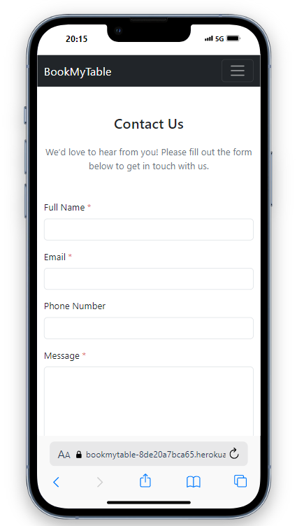 | 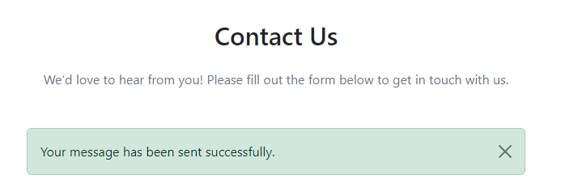 |

### Admin Back Office

Staff with superuser rights manage **tables**, **menu categories**, **menu items** (Summernote rich-text descriptions, Cloudinary images), **reservations** and **contact messages** through the Django admin at `/admin/`.

## Technologies Used

| Category | Technology | Purpose |
| -------- | ---------- | ------- |
| Backend | Python, Django 6.1 | Web framework (MTV pattern) |
| Database | SQLite (dev) / PostgreSQL (prod) | Persistent storage |
| Authentication | django-allauth | Registration, login, logout, sessions |
| Rich text | django-summernote | WYSIWYG editor in the admin |
| Media storage | Cloudinary | Cloud-hosted menu images |
| Frontend | HTML5, CSS3, JS, Django Templates, Bootstrap 5.3 | Responsive UI |
| Production | Gunicorn, Whitenoise | WSGI server and static files |
| Hosting | Heroku | Cloud deployment |
| Tools | Git/GitHub, VS Code, Moqups, DBDiagram | Version control, IDE, wireframes, ERD |

## Project Structure

```text
BookMyTable-main/
  +-- README.md                  # this file
  +-- requirements.txt          # project dependencies
  +-- manage.py                 # Django management entry point
  +-- bookings/                 # project settings, URLs, WSGI/ASGI
  +-- pages/                    # home page app (+ tests)
  +-- table/                    # table model, views (+ tests)
  +-- menu/                     # menu category / item apps (+ tests)
  +-- reservations/             # core reservation app (+ tests)
  +-- contact/                  # contact form app (+ tests)
  +-- static/                   # custom CSS / JavaScript
  +-- templates/                # base template + allauth account templates
  +-- docs/                     # diagrams, screenshots, graduation paper
  +-- db.sqlite3                # local development database
```

---

## Setup and Installation

### Prerequisites

- Python 3.10+ (the project was developed against Python 3.14)
- pip
- (optional but recommended) PostgreSQL for production

### 1. Clone or download the repository

```bash
git clone https://github.com/Saiful-JCU/BookMyTable
cd BookMyTable-master 
```

### 2. Create and activate a virtual environment

```bash
python -m venv venv
# Windows (Git Bash / PowerShell)
source venv/Scripts/activate
# macOS / Linux
# source venv/bin/activate
```

### 3. Install the dependencies

```bash
pip install -r requirements.txt
```

### 4. Apply database migrations

```bash
python manage.py makemigrations
python manage.py migrate
```

### 5. Create a superuser (admin back office)

```bash
python manage.py createsuperuser
```

### 6. Run the development server

```bash
python manage.py runserver
```

Open <http://127.0.0.1:8000> in your browser. The admin panel is at <http://127.0.0.1:8000/admin/>.

## Configuration

The application expects the following environment variables (in production, set them via Heroku config vars or an `env.py` file that is excluded from version control):

| Variable | Description |
| -------- | ----------- |
| `SECRET_KEY` | Django secret key |
| `DATABASE_URL` | Connection string of the production database (PostgreSQL) |
| `CLOUDINARY_URL` | Cloudinary credentials for media storage |

In development, the settings in `bookings/settings.py` fall back to the bundled **SQLite** database (`db.sqlite3`) and `DEBUG = True`. For production, paste your cloud database URL into the commented `dj_database_url` block, set `ALLOWED_HOSTS` and run `python manage.py collectstatic`.

## Testing

### Automated tests

The project ships with an automated test suite written with the Django/`unittest` framework, organised per app (`pages`, `table`, `menu`, `contact`, `reservations`). It covers models, views, form validation, access control and the reservation business rules (duplicate-date prevention, capacity limit, operating hours).

Run the complete suite:

```bash
python manage.py test
```

Run a single app's tests:

```bash
python manage.py test reservations
```

### Test results

| Test type | Total | Passed | Pass rate |
| --------- | ----- | ------ | --------- |
| Model tests | 12 | 12 | 100% |
| View / integration tests | 19 | 19 | 100% |
| **Total** | **31** | **31** | **100%** |

```text
$ python manage.py test
Creating test database for alias 'default'...
...............................
Ran 31 tests in 59.337s
OK
```

Two defects were found and fixed during testing:

1. **Menu page crash for menu items without an image** — `menu_item_list.html` called `item.image.url` unconditionally, raising a `ValueError`; the template now guards with `` and shows a placeholder.
2. **Unordered pagination warning** — adding `.order_by('id')` in `menu/views.py` removed Django's `UnorderedObjectListWarning`.

### Manual testing & validation

- All user flows (registration, login, logout, reservations, menu, contact, admin) were manually tested on desktop and mobile browsers.
- HTML/CSS validated with the W3C validators; Python validated against PEP 8; Lighthouse audits (performance, accessibility, best practices, SEO) were recorded for desktop and mobile.

## Deployment

### Deploying to Heroku

1. Push the repository to GitHub.
2. In Heroku, **Create New App**, name it, and choose the region.
3. Connect the app to your GitHub repository (deployment method: **GitHub**) and enable automatic deploys from `main`.
4. Set the **Config Vars**: `SECRET_KEY`, `DATABASE_URL`, `CLOUDINARY_URL`.
5. Add the **buildpack**: `python`.
6. Set a `Procfile` with `web: gunicorn bookings.wsgi`.
7. Run **Deploy Branch**, then open the app URL.
8. Run `python manage.py migrate` and `python manage.py createsuperuser` in the Heroku console to initialise the database.

### Forking / cloning

Use the **Fork** button on GitHub to create your own copy, or clone the repository with `git clone <repository-url>`.

## Documentation

This project is accompanied by a complete **Software Development Document** following the course graduation-thesis specification:

| File | Description |
| ---- | ----------- |
| `docs/Software_Development_Document.md` | Full graduation paper in Markdown (Introduction, Requirements Analysis, Software Design, Implementation, Testing, Summary, References, Appendices). |
| `docs/Software_Development_Document.docx` | The same paper formatted as a Word document (A4, Times New Roman, 1.5 spacing, page numbers). |
| `docs/build_docx.py` | Reusable script that converts the Markdown paper into the formatted Word document. |
| `docs/database-diagram.png` | Entity-relationship diagram of the database. |

## Credits and Acknowledgements

- **Framework:** [Django](https://www.djangoproject.com/) and the Django community's excellent documentation.
- **UI library:** [Bootstrap 5](https://getbootstrap.com/) for the responsive layout and components.
- **Icons & fonts:** [Font Awesome](https://fontawesome.com/) and [Google Fonts](https://fonts.google.com/).
- **Authentication:** [django-allauth](https://django-allauth.readthedocs.io/).
- **Rich text:** [django-summernote](https://github.com/summernote/django-summernote).
- **Media hosting:** [Cloudinary](https://cloudinary.com/).
- **Hosting:** [Heroku](https://www.heroku.com/).
- **Inspiration:** Code Institute's *I Think Therefore I Blog* walkthrough project.
- **Media:** all images were sourced from [Unsplash](https://www.unsplash.com).
- **Written content:** created with the assistance of ChatGPT for speed and efficiency.
- **Mentoring & feedback:** thanks to the course mentor, classmates and family for testing and feedback.

---

*BookMyTable — designed and developed with Django. Made with love by Florin Pinta (xttrust).*
